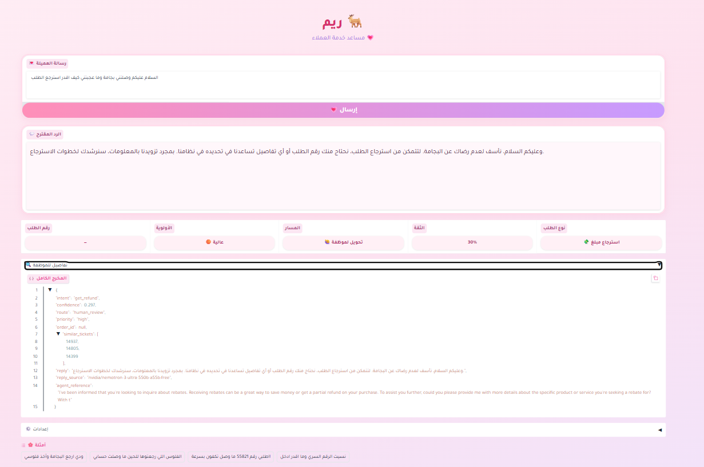
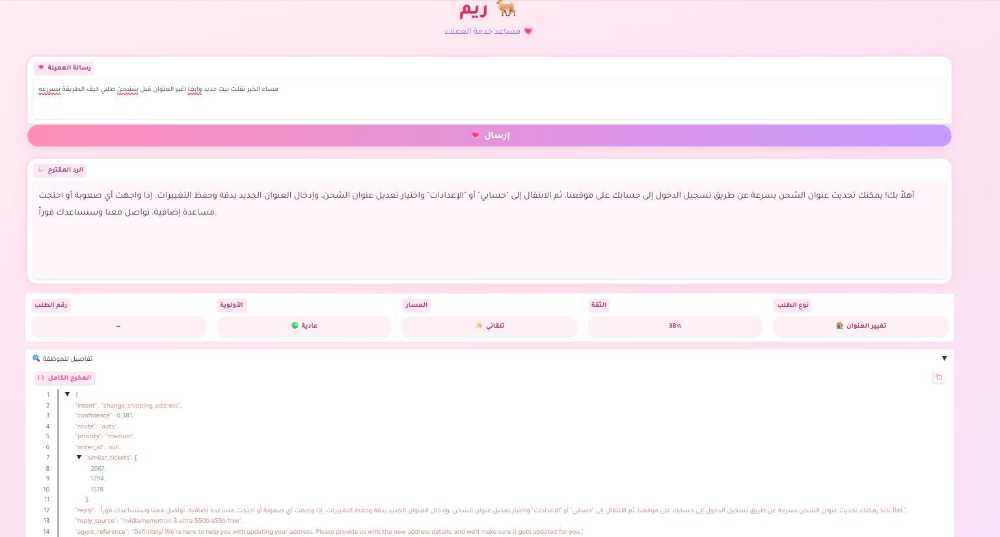

# 🎫 Ticket Assistant for Gulf Arabic Customer Support

**Capstone project — [SDAIA Academy](https://github.com/SDAIAAcademy) · Applied NLP Bootcamp**
Solo project by **selooo0**

[](https://colab.research.google.com/github/selooo0/gulf-ticket-assistant/blob/main/ticket_assistant.ipynb)

---

## 1. The Problem

Customers in the Gulf write support tickets in **Gulf dialect** (e.g. *"ابي الغي طلبي ما عاد احتاجه"*), not in English or Modern Standard Arabic.
The course baseline models do well on English and MSA but break down on dialect:

| Model (trained on course data) | English | MSA | **Gulf** |
|---|---|---|---|
| multilingual-e5-small + LR | ~0.99 | 0.624 | **0.307** |
| paraphrase-multilingual-MiniLM + LR | ~0.99 | 0.843 | **0.307** |

*(Macro-F1, course Arabic test sets)*

**Goal:** an **Agent Assist** tool for support staff. For every incoming ticket it gives the intent, the priority and the order number, and it drafts a reply. It also knows when it is **not sure** and hands the ticket to a human.

> This is a tool for the support agent, not a customer-facing chatbot. A human stays in the loop.

---

## 2. Inputs & Outputs

**Input:** one customer message (free text, Gulf Arabic / MSA / English)

**Output (JSON):**

| Field | How it is produced |
|---|---|
| `intent` | one of 8 intents: embeddings + Logistic Regression |
| `confidence` | classifier probability |
| `route` | `auto` if confidence ≥ τ (0.30), else `human_review` |
| `priority` | rules: urgent words / `!!` / sensitive intents → `high` |
| `order_id` | Regex (the cheapest tool for structured fields) |
| `similar_tickets` | top-3 past tickets (RAG, filtered by predicted intent) |
| `reply` | short Arabic reply drafted by an LLM, grounded only in the retrieved agent replies |
| `agent_reference` | the closest past agent reply, for the employee only |

**8 intents:** `track_order`, `cancel_order`, `change_shipping_address`, `track_refund`, `get_refund`, `payment_issue`, `complaint`, `recover_password`

---

## 3. Data

| File (`data/`) | Rows | Source | Used for |
|---|---|---|---|
| Course tickets (`nlp_utils.load_tickets`) | — | SDAIA Academy course data (Bitext-based customer support) | English training + RAG history (agent replies) |
| `gulf_train.csv` | 190 | Generated with an LLM (Claude), then reviewed by me | Gulf training data |
| `gulf_train_split.csv` | 147 | `gulf_train` minus 40 for validation, minus 3 near-duplicates of the test set | Final Gulf training |
| `gulf_val.csv` | 40 | Stratified split from `gulf_train` | Choosing models and τ |
| `NLP_Intent_Classification.csv` | 40 | **Written by hand by me** (5 per intent) | **Final test set, never used for training or tuning** |
| `generated_replies.csv` | 32 | LLM output | Reply evaluation |
| `manual_labels.csv` | 32 | **My manual labels** | Human evaluation of replies |
| `judge_labels.csv`, `human_vs_judge.csv` | 32 | LLM judge output | Judge vs. human comparison |

**Data quality checks**
- **Generated data review:** 32 random training sentences reviewed by hand, 31/32 correct (97%).
- **Leakage check:** every test sentence compared to the training set (cosine > 0.95). Two pairs were similar but had different meanings; 3 training rows were removed to be safe.
- **Test discipline:** models and τ were chosen on **validation only**, and the test set was used once at the end.

---

## 4. Approach

```
customer message
      │
      ├─► e5 embedding ─► Logistic Regression ─► intent + confidence ─► route (τ = 0.30)
      ├─► Regex ─────────────────────────────► order_id
      ├─► rules ─────────────────────────────► priority
      └─► retrieval (top-3, same intent) ─► LLM (generation) ─► Arabic reply
```

### Model choices and why

| Component | Choice | Why |
|---|---|---|
| Embeddings | `intfloat/multilingual-e5-small` | Best Gulf F1 after adding Gulf data (beats MiniLM on test and val), small enough for CPU |
| Classifier | Logistic Regression (C=4) | Fast, gives calibrated-enough probabilities for the confidence threshold, strong with good embeddings |
| Field extraction | Regex | Order IDs have a fixed pattern, so no model is needed |
| Generation LLM | `nvidia/nemotron-3-ultra-550b-a55b:free` (OpenRouter) | Free, strong Arabic output |
| Judge LLM | `dots-studio/dots-3-note-preview:free` (OpenRouter) | A **different model family** from the generator, to avoid self-grading |
| Fine-tuning | Not in the main pipeline (bonus) | Embeddings + LR already reach 0.79 with very little Gulf data |

---

## 5. Results

### 5.1 Intent classification (Macro-F1)

| Model | Gulf **test** (40) | Gulf val (40) | English |
|---|---|---|---|
| TF-IDF + LR | 0.000 | — | — |
| e5 + LR (course data only) | 0.265 | — | — |
| MiniLM + LR (course data only) | 0.396 | 0.274 | 0.994 |
| MiniLM + LR + Gulf data | 0.776 | 0.668 | 0.994 |
| **e5 + LR + Gulf data (chosen)** | **0.791** | **0.734** | **0.995** |

Adding only **147 Gulf sentences** raised Gulf F1 from 0.27 to **0.79** without hurting English.

### 5.2 Confidence threshold τ (chosen on validation)

| τ | Sent automatically | Accuracy of auto tickets |
|---|---|---|
| 0.50 (course default) | 18% | 100% |
| **0.30 (chosen)** | **55%** | **91%** |
| 0.20 | 82% | 82% |

0.50 was too strict for dialect. 0.30 automates more than half of the tickets and keeps accuracy above 90%.

### 5.3 Retrieval (RAG)

| | Baseline (all tickets) | **Filtered by predicted intent** |
|---|---|---|
| Hit@3 (at least one relevant) | 0.42 | **0.78** |
| All 3 relevant | 0.18 | **0.78** |
| Avg. relevant in top-3 | 0.90 | **2.33** |

*Trade-off:* filtered retrieval depends on the classifier. If the intent is wrong, the retrieved tickets are wrong too.

### 5.4 Reply quality (32 replies, labelled by hand)

| Metric | Score |
|---|---|
| Answers the customer's request | **75%** |
| Grounded (no invented facts) | **91%** |

**By number of relevant retrieved tickets:**

| Relevant in top-3 | Tickets | Answers | Grounded |
|---|---|---|---|
| 0 | 19 | 0.74 | 0.84 |
| 1 | 3 | 0.67 | 1.00 |
| 2 | 4 | 0.50 | 1.00 |
| 3 | 6 | **1.00** | **1.00** |

➡️ **Retrieval is the weak link.** Every ungrounded reply happened when retrieval failed. When all 3 retrieved tickets were relevant, every reply was correct.

### 5.5 LLM-as-a-judge vs. human

| | Agreement | Cohen's Kappa |
|---|---|---|
| Answers | 75% | 0.00 (the judge said "yes" 100% of the time) |
| Grounded | 50% | −0.05 |

The judge was **not reliable**: it was too lenient on "answers" and too strict on "grounded". Part of this was my fault: the judge prompt said "no promises of actions" while the system prompt allows "a colleague will follow up", so the judge marked 14 of those replies as ungrounded. **Lesson:** an LLM judge must be checked against human labels before it can be trusted.

---
## 6. Error Analysis

9 of the 40 test sentences were misclassified:
- **8 of 9 were routed to a human** (low confidence), so the threshold caught them safely.
- **1 was dangerous:** *"ما توصلني رسالة اعادة تعيين الرقم السري على الايميل"* → predicted `change_shipping_address` with confidence 0.36 and sent automatically.

**Patterns**
- Bias toward `track_refund` (4 of 9 errors)
- Confusion between `track_order` and `track_refund`
- Local terms the model never saw: *"مدى"*, *"الرقم السري"*
- Messages with two intents, e.g. *"ألغيت الطلب وفلوسي الى الان مارجعت"* (cancel + refund): predicted `cancel_order` with only **17%** confidence, so it went to a human.

**Example: a request outside the 8 intents, handled safely**



*"وصلتني بجامة وما عجبتني كيف اقدر استرجع الطلب"*: the customer wants to **return** a product, and "return" is not one of the 8 intents. The closest intent is `get_refund`, but confidence was only **30%** (below τ = 0.30), so the ticket went to **human review**. Priority is **high** because refund tickets are sensitive.

---

## 7. Demo

Gradio UI (the assistant is called **"ريم"**, styled for a pajama store 🌙). It shows the suggested reply, intent, confidence, route, priority and order number, plus a details panel for the employee.



**Example (same as the screenshot)**

Input:

```
مساء الخير نقلت بيت جديد وابغا اغير العنوان قبل يشحن طلبي كيف الطريقة بسرعة
```

Output:

```json
{
  "intent": "change_shipping_address",
  "confidence": 0.38,
  "route": "auto",
  "priority": "medium",
  "order_id": null,
  "reply": "أهلاً بك! يمكنك تحديث عنوان الشحن بسرعة عن طريق تسجيل الدخول إلى حسابك على موقعنا، ثم الانتقال إلى \"حسابي\" أو \"الإعدادات\" واختيار تعديل عنوان الشحن...",
  "reply_source": "nvidia/nemotron-3-ultra-550b-a55b:free"
}
```

Confidence (0.38) is above τ, so the ticket is handled automatically and the LLM drafts a clear Arabic reply.

---


## 8. How to Run

1. Open `ticket_assistant.ipynb` in Google Colab (CPU is enough).
2. Put the files from `data/` in Google Drive under `MyDrive/ticket_assistant/`.
3. Add your OpenRouter key in **Colab → Secrets (🔑)** as `OPENROUTER_API_KEY`. **Never write the key in the code.**
4. **Runtime → Run all.** Cells that call the API skip work whose results are already saved, so re-running does not use up the free quota (50 requests/day).
5. The last cell launches the Gradio demo with a public link.

---

## 9. Ethics & Limitations

- **Privacy:** the fallback reply is a fixed message. Past agent replies (which may contain other customers' order numbers) are shown **only to the employee**, never sent to the customer.
- **Human in the loop:** low-confidence tickets always go to a human, and the reply is a draft for the agent.
- **Generated training data:** the Gulf training sentences were LLM-generated and spot-checked, so they may not cover every dialect or writing style.
- **Small test set:** 40 sentences (5 per intent), so the scores have wide uncertainty.
- **Dialect coverage:** mainly Saudi/Gulf. Other dialects were not tested.
- **One intent per ticket:** messages with two requests are not handled yet.
- **Free API models:** availability and rate limits can change.

---

## 10. Next Steps

- Fine-tune a multilingual model on Gulf data (bonus)
- Collect real (anonymized) Gulf tickets to replace generated data
- Support multi-intent tickets
- Improve retrieval so it doesn't depend fully on the classifier
- Better judge prompt, validated against human labels

---

## Acknowledgements

Built during the **[SDAIA Academy](https://github.com/SDAIAAcademy)** Applied NLP Bootcamp, using the course utilities from [`SDAIAAcademy/applied-nlp`](https://github.com/SDAIAAcademy/applied-nlp).
